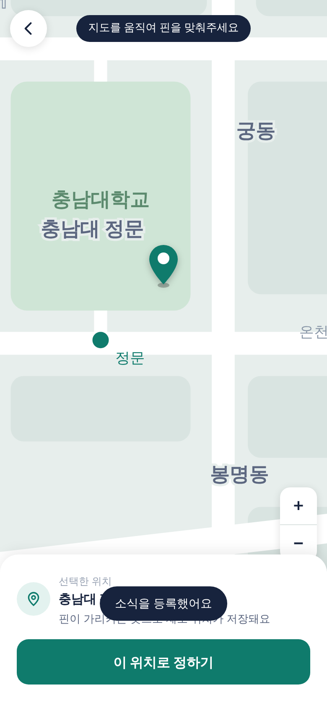
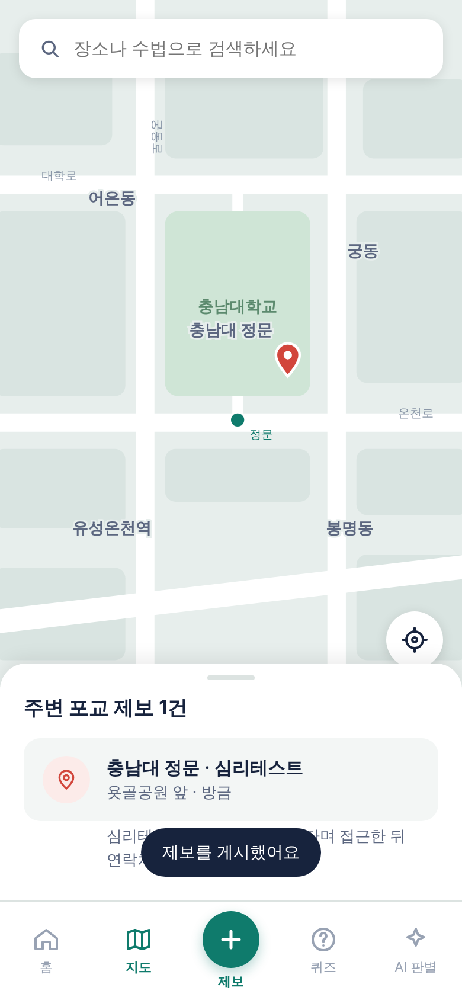
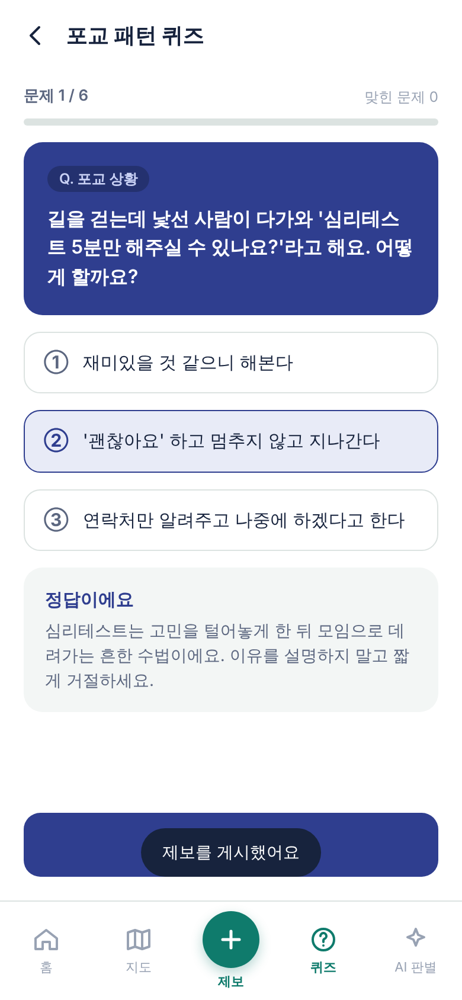
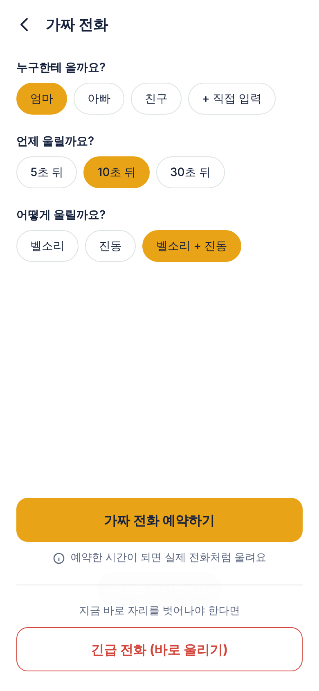
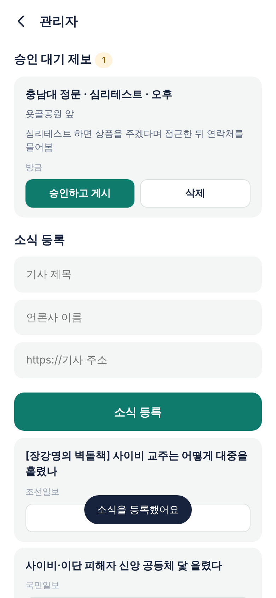

# 사이비켜: 길거리 포교 판별·예방 서비스

> 충남대학교 어드벤처디자인(2026-2) 팀 프로젝트
> 대학생이 길거리·캠퍼스 포교를 **알아보고, 벗어나고, 함께 알릴 수 있도록** 돕는 모바일 웹 서비스

| 웹앱 | Figma 디자인 |
|---|---|
| [사이비켜 웹앱 열기](https://claude.ai/artifact/4ThLhj1rkRgLMdKEndBmST) | [Figma 파일 열기](https://www.figma.com/design/otjMvIPtjZu7n0PMSG6wtG) |

<p>
  
  
  
  
</p>

---

## 1. 프로젝트 개요

캠퍼스 주변에서는 설문조사, 심리테스트, 인터뷰 요청 등으로 위장한 포교가 자주 일어나요. 처음에는 포교인지 알아차리기 어렵고, 알아차려도 자리를 벗어나기 곤란한 경우가 많아요. 또 어디서 이런 일이 자주 일어나는지 정보가 흩어져 있어 미리 조심하기도 어려워요.

**사이비켜**는 이 문제를 세 가지 키워드로 해결해요.

| 키워드 | 의미 | 기능 |
|---|---|---|
| **판별** | 지금 상황이 포교인지 알아본다 | AI 의심도 판별, 포교 패턴 퀴즈 |
| **회피** | 위험한 순간에 자리를 벗어난다 | 가짜 전화, 위치 알림 |
| **공유** | 겪은 사람이 알리고 함께 조심한다 | 제보 지도, 관리자 승인 |

## 2. 디자인씽킹 과정

### 공감 (Empathize)
- 팀원별 외부인 2명 이상 인터뷰 및 맥락 질의
- <!-- TODO: 인터뷰 대상, 인원, 주요 발견점을 정리해 주세요 -->

### 문제 정의 (Define)
- **페르소나:** 나순진 (20세, 여, 대학생)
- **POV:** 나순진은 사이비 포교에 당하지 않기를 원한다. 왜냐하면 시간을 허비하지 않고, 정신적인 부담을 느끼고 싶지 않기 때문이다.
- **HMW:** <!-- TODO: 팀에서 정한 HMW 질문을 적어 주세요 -->

### 아이디어 (Ideate)
- 브레인스토밍 → 친화도법 → 다중투표로 기능 선정
- 선정된 기능: 포교 패턴 교육, 상황 판별, 제보 기반 지도, 상황 탈출용 가짜 전화

### 프로토타입 (Prototype)
1. **Figma 와이어프레임:** 화면 구조와 이동 흐름 설계 (`메인 화면` → `정리된 초안` 페이지)
2. **패드 손그림 초안:** 팀원과 화면별 세부 구성 논의
3. **Figma 상세 디자인:** 색·문구·아이콘을 적용한 클릭형 프로토타입 (`상세 디자인` 페이지)
4. **웹앱:** 실제로 동작하는 모바일 웹 서비스 (`src/index.html`)

### 테스트 (Test)
- <!-- TODO: 사용자 테스트 대상, 방법(Think Aloud 등), 피드백과 수정 사항을 정리해 주세요 -->

## 3. 주요 기능

- [x] **제보하기:** 카카오T처럼 지도를 움직여 정확한 위치를 고르고, 접근 수법·시간대·상황을 입력
- [x] **관리자 승인:** 제보는 관리자가 확인한 뒤에만 지도에 게시 (허위 제보·비방 방지)
- [x] **제보 지도:** 승인된 제보를 정확한 위치의 핀으로 표시, 검색 가능
- [x] **포교 의심도 판별 AI:** 상황을 입력하면 상·중·하 의심도와 대처 방법을 안내하고 비슷한 제보 사례를 보여줌
- [x] **포교 패턴 퀴즈:** 실제 접근 상황 6문제, 정답 해설과 점수
- [x] **가짜 전화:** 발신자·시간·벨소리/진동을 정해 예약하거나 바로 울리기, 통화 중 대사 안내
- [x] **위치 알림 설정:** 알림 범위·시간 설정과 알림 미리보기
- [x] **기타 정보:** 112, 학교 상담센터, 현대종교, 지역별 이단 상담소 연락처와 대처 가이드 글
- [x] **사이비 관련 소식:** 관리자가 등록한 기사 목록

## 4. 화면 구성

| 메인 | 메뉴 | 제보하기 | 위치 선택 |
|---|---|---|---|
|  |  |  |  |

| 제보 완료 | 제보 지도 | 퀴즈 | AI 판별 |
|---|---|---|---|
|  |  |  |  |

| 가짜 전화 | 전화 수신 | 관리자 | 기타 정보 |
|---|---|---|---|
|  |  |  |  |

## 5. 디자인 원칙

- **색:** 청록(메인, 안심) · 남색(판별 기능) · 주황(회피 기능) · 빨강(위험 표시에만 사용)
- 공포감을 주는 검정·빨강 조합과, 종교적 느낌을 줄 수 있는 보라색은 피함
- 모든 화면을 스마트폰 한 손 사용 기준으로 설계 (하단 탭, 가운데 제보 버튼)

## 6. 파일 구성

```
saibikyeo/
├── README.md
├── src/
│   └── index.html          # 웹앱 전체 (HTML·CSS·JavaScript 한 파일)
└── docs/
    └── screenshots/        # README용 화면 캡처
```

## 7. 기술 구성 및 실행 방법

- **화면:** HTML, CSS, JavaScript (프레임워크 없이 한 파일로 구성)
- **글꼴:** IBM Plex Sans KR
- **데이터 저장·AI 판별:** claude.ai 아티팩트 기능 사용
  - 이 환경 밖에서 열면 제보·소식은 **각자 브라우저에만 저장**되고, AI 판별은 키워드 기반 **기본 분석**으로 동작해요.

**실행 방법**
1. 이 저장소를 내려받거나 `src/index.html` 파일을 내려받아요.
2. 파일을 브라우저로 열면 바로 실행돼요. 설치는 필요 없어요.
3. 스마트폰 화면으로 보려면 브라우저 개발자 도구의 모바일 보기를 켜세요.

## 8. 한계와 향후 계획

- [ ] **누구나 제보할 수 있도록 Firebase로 이전:** 현재는 초대받은 사람만 제보를 저장할 수 있음
- [ ] **실제 지도 연동:** 카카오맵 API로 그림 지도를 바꾸고, 선택한 위치를 실제 주소로 표시
- [ ] **실시간 위치 알림:** 현재 위치 기반으로 제보가 많은 곳 근처에서 알림
- [ ] **상담소 정보 검증:** 공개 전에 연락처와 운영 정보를 다시 확인

## 9. 팀원

<!-- TODO: 팀 이름, 팀원 이름과 역할을 채워 주세요 -->

| 이름 | 역할 |
|---|---|
|  |  |
|  |  |
|  |  |
